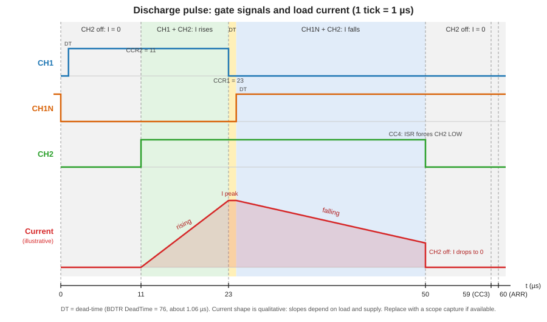
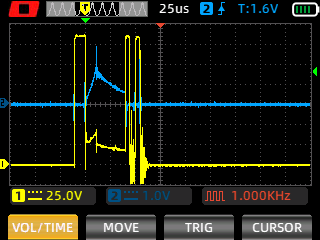
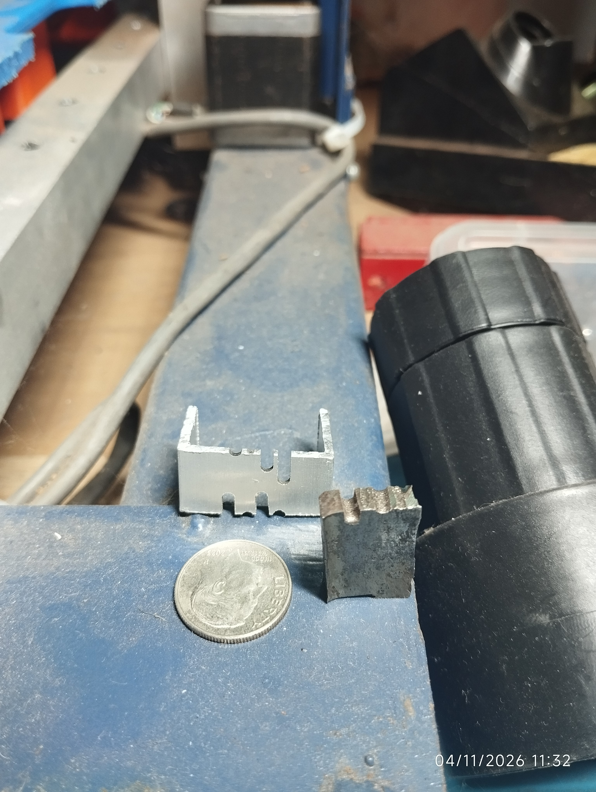
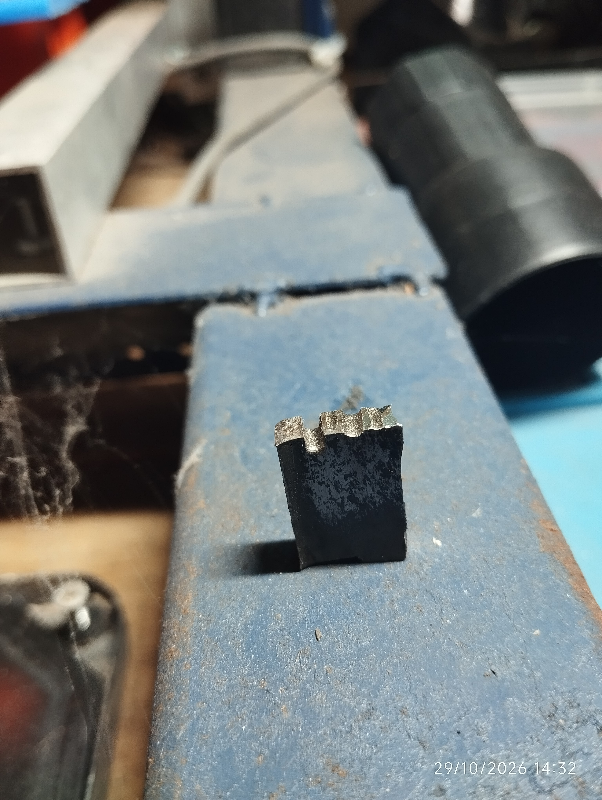
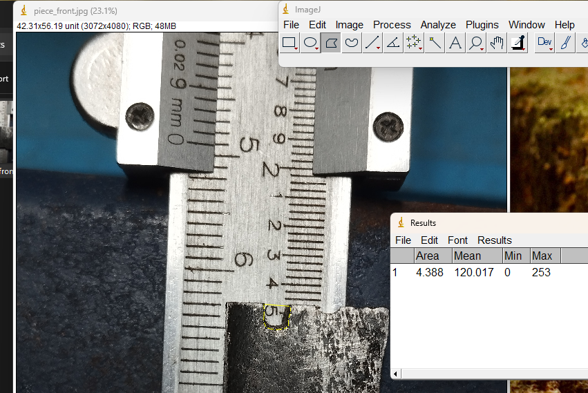

# stm32-sinker-edm

### Open-Source Low-Cost Sinker EDM (STM32)

  

An ultra-low-cost, open-source **Sinker Electrical Discharge Machining (EDM)** prototype designed to make precision hard-metal subtractive manufacturing accessible. Built from the ground up using recycled telecom power supplies, custom single-sided PCBs, and locally sourced mechanical components.

---

## 🎥 Demonstration & Working Principle

### 1. Live Machining Demos
<table align="center" border="0" cellspacing="0" cellpadding="10" style="display:table; width:auto; margin:0 auto; border:none;">
  <tr>
    <td align="center" valign="bottom" style="text-align:center; border:none; background:none;">
      <b>📺 Full Machining Demo</b> 
      
    </td>
    <td align="center" valign="bottom" style="text-align:center; border:none; background:none;">
      <b>📱 Spark Generation Short</b> 
      
    </td>
    <td align="center" valign="bottom" style="text-align:center; border:none; background:none;">
      <b>⚡ Quick Overview Short</b> 
      
    </td>
  </tr>
</table>

### 2. From Pulse Theory to Real Spark Discharge
The power stage uses a dual-channel IGBT switching sequence (`CH1` / `CH1N` and `CH2`) to first establish an open-circuit ionization potential across the dielectric gap (~156 VDC), followed by mid-pulse high-current discharge (~40 A peak) once dielectric breakdown occurs:

<table align="center" border="0" cellspacing="0" cellpadding="10" style="display:table; width:100%; margin:0 auto; border:none;">
  <tr>
    <td align="center" valign="top" width="52%" style="text-align:center; border:none; background:none;">
      
       
      <b>Fig 1. Theoretical Switching & Current Profile:</b> Gate timing for CH1, CH1N, and CH2 alongside the expected discharge current peak.
    </td>
    <td align="center" valign="top" width="48%" style="text-align:center; border:none; background:none;">
      
       
      <b>Fig 2. Experimental Spark Capture:</b> Initial open-circuit voltage plateau followed by mid-pulse dielectric breakdown and sustained arc voltage.
    </td>
  </tr>
</table>

### 3. Machined Samples & Optical Cavity Measurement
Physical erosion trials on aluminum and structural steel demonstrate controlled material removal, quantified via calibrated optical area analysis in **ImageJ** (achieving up to **4.30 mm³/min** MRR on aluminum):

<table align="center" border="0" cellspacing="0" cellpadding="10" style="display:table; width:100%; margin:0 auto; border:none;">
  <tr>
    <td align="center" valign="top" width="30%" style="text-align:center; border:none; background:none;">
      
       
      <b>Fig 3. Workpieces Detail</b>
    </td>
    <td align="center" valign="top" width="30%" style="text-align:center; border:none; background:none;">
      
       
      <b>Fig 4. Steel Surface Finish</b>
    </td>
    <td align="center" valign="top" width="40%" style="text-align:center; border:none; background:none;">
      
       
      <b>Fig 5. Optical MRR Metrology:</b> Cavity surface area measurement in ImageJ with scale calibration and eroded boundary selection.
    </td>
  </tr>
</table>

---

## 📌 A. Project Overview

### What problem does it solve?
Advanced subtractive manufacturing—specifically Electrical Discharge Machining (EDM)—is traditionally prohibitively expensive, limiting access to high-precision hard-metal cutting in low-income regions, small workshops, and educational environments. This project tackles that barrier by creating an open-source, ultra-low-cost sinker EDM machine built from the ground up using mostly recycled and locally available components.

### What was built?
A complete prototype system consisting of:
- A custom **spark-generating power unit** handling up to ~156 VDC (three series-connected recycled telecom PSUs) and delivering adjustable pulses up to ~40 A.
- Real-time **pulse monitoring and sensing** using LM311 comparators, keeping a tight 61 µs pulse width (establishing a theoretical 16.6 kHz frequency ceiling).
- A mechanical linear axis driven by standard **NEMA 17 stepper motors** (12,800 microsteps per 2 mm) to control electrode feed and gap regulation.
- An **STM32 microcontroller** core running refactored, English-documented firmware.

### Current development status
- **Status:** Experimental prototype ("As-Is").
- **Testing Note:** The control logic has been refactored, but it must be rigorously tested dry (without high-voltage rails or high-power IGBT stages) before live deployment.
- **Philosophy:** *It cuts indeed.*

---

## 📑 Documentation Index

Explore the detailed technical documentation for each subsystem below:

- **[B. System Architecture](docs/architecture.md)** — Block diagrams, power electronics topology, control loop logic, and user interface layout.
- **[C. Hardware & Bill of Materials](docs/hardware.md)** — Recycled component sourcing, custom single-sided PCB fabrication, and physical assembly.
- **[D. Firmware & Control Logic](docs/control.md)** — Keil uVision project structure, state machines, pulse-monitoring routines, and safety/fault handling.
- **[E. Experimental Results & Oscilloscope Captures](docs/experimental-results.md)** — Cutting tests (MRR), gate drive signals, short/open-circuit waveforms, current noise analysis, and limitations.
- **[F. Engineering Decisions & Trade-offs](docs/engineering-decisions.md) (Coming Soon)** — Sinker vs. Wire EDM choice, reusing telecom power supplies (-50 VDC), opting for IGBTs with built-in flyback diodes, method of short/spark detection, and cost optimization.
- **[G. Future Improvements](docs/future-improvements.md) (Coming Soon)** — Fluid flushing systems, advanced instrumentation, closed-loop actuator speed optimization, and next-gen roadmap.

---

  <a href="#stm32-sinker-edm">⬆️ Back to Top</a>

