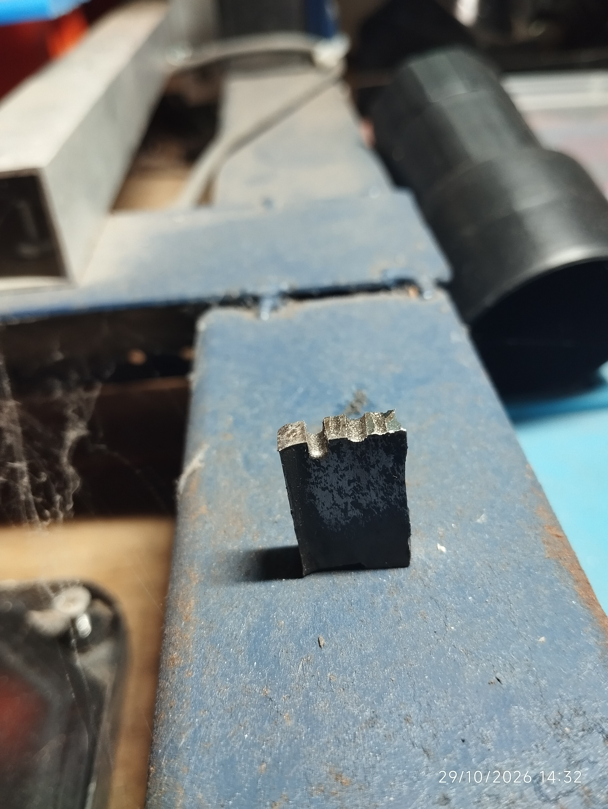

# stm32-sinker-edm

# Open-Source Low-Cost Sinker EDM (STM32)

  

  
   
  <em>📱 Watch the full YouTube Short demo</em>

 

An ultra-low-cost, open-source Sinker Electrical Discharge Machining (EDM) prototype designed to make advanced subtractive manufacturing accessible. Built using mostly recycled components and standard locally-sourced parts.

---

## 🎥 Demo & Working Principle

<h2 align="center" style="text-align:center; border:none;">🎥 Demonstration & Results</h2>

<!-- FILA 1: VIDEOS -->
<table align="center" border="0" cellspacing="0" cellpadding="10" style="display:table; width:auto; margin:0 auto; border:none;">
  <tr>
    <td align="center" valign="bottom" style="text-align:center; border:none; background:none;">
      <b>📺 Full Demo</b> 
      
    </td>
    <td align="center" valign="bottom" style="text-align:center; border:none; background:none;">
      <b>📱 Short Demo</b> 
      
    </td>
  </tr>
</table>

<!-- FILA 2: FOTOS (ahora clicables, abren la imagen completa) -->
<table align="center" border="0" cellspacing="0" cellpadding="10" style="display:table; width:auto; margin:0 auto; border:none;">
  <tr>
    <td align="center" valign="top" style="text-align:center; border:none; background:none;">
      
       
      <i>Fig 1. Workpieces detail</i>
    </td>
    <td align="center" valign="top" style="text-align:center; border:none; background:none;">
      
       
      <i>Fig 2. Surface finish</i>
    </td>
  </tr>
</table>

---

## 📌 A. Project Overview

### What problem does it solve?
Advanced subtractive manufacturing—specifically Electrical Discharge Machining (EDM)—is traditionally prohibitively expensive, limiting access to high-precision hard-metal cutting in low-income regions, small workshops, and educational environments. This project tackles that barrier by creating an open-source, ultra-low-cost sinker EDM machine built from the ground up using mostly recycled and locally available components.

### What was built?
A complete prototype system consisting of:
* A custom **spark-generating power unit** handling up to 150VDC and delivering adjustable pulses up to ~40A.
* Real-time **pulse monitoring and sensing** using LM311 comparators, keeping a tight 60 µs pulse width (establishing a theoretical 16.6 kHz frequency ceiling).
* A mechanical linear axis driven by standard **NEMA 17 stepper motors** to control electrode feed.
* An **STM32 microcontroller** core running refactored, English-documented firmware.

### Current development status
* **Status:** Experimental prototype ("As-Is").
* **Testing Note:** The control logic has been refactored, but it must be rigorously tested dry (without high-voltage rails or high-power IGBT stages) before live deployment.
* **Philosophy:** *It cuts indeed.*

---

## 📑 Documentation Index

Explore the detailed technical documentation for each subsystem below:

* **[B. System Architecture](docs/architecture.md)** — Block diagrams, power electronics topology, control loop logic, and user interface layout.
* **[C. Hardware & Bill of Materials](docs/hardware.md)** — recycled component sourcing, and physical assembly insides.
* **[D. Firmware & Control Logic](docs/control.md)** — Keil uVision project structure, state machines, pulse-monitoring routines, and safety/fault handling.
* **[E. Experimental Results & Oscilloscope Captures](docs/experimental-results.md) (Coming Soon)** — Short/open-circuit waveforms, gate drive signals, current noise analysis, cutting tests, and limitations.
* **[F. Engineering Decisions & Trade-offs](docs/engineering-decisions.md) (Coming Soon)** — Sinker vs. Wire EDM choice, reusing telecom power supplies (-50VDC), opting for IGBTs with built-in flyback diodes, method of short/spark detection, and cost optimization.
* **[G. Future Improvements](docs/future-improvements.md) (Coming Soon)** — Fluid flushing systems, advanced instrumentation, closed-loop actuator speed optimization, and next-gen roadmap.

---

  <a href="#stm32-sinker-edm">⬆️ Back to Top</a>

