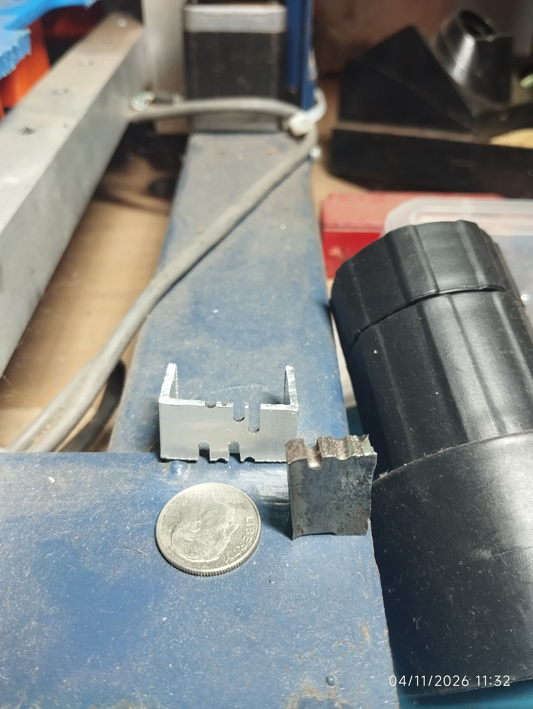

# stm32-sinker-edm

# Open-Source Low-Cost Sinker EDM (STM32)

  

  <em>📱 Watch the full YouTube Short demo</em>

An ultra-low-cost, open-source Sinker Electrical Discharge Machining (EDM) prototype designed to make advanced subtractive manufacturing accessible. Built using mostly recycled components and standard locally-sourced parts.

---

## 🎥 Demo & Working Principle

<!-- SECCIÓN DE DEMOSTRACIÓN Y RESULTADOS -->
<h2 align="center">🎥 Demonstration & Results</h2>

<!-- FILA 1: VIDEOS LADO A LADO -->
<table align="center" border="0" cellspacing="0" cellpadding="10">
  <tr>
    <td align="center" valign="bottom" width="260">
      
<b>📺 Full Demo</b>

      
    </td>
    <td align="center" valign="bottom" width="180">
      
<b>📱 Short Demo</b>

      
    </td>
  </tr>
</table>

<!-- FILA 2: FOTOS DE LAS PIEZAS LADO A LADO -->
<table align="center" border="0" cellspacing="0" cellpadding="10">
  <tr>
    <td align="center" valign="top" width="240">
      
      
<i>Fig 1. Workpieces detail</i>

    </td>
    <td align="center" valign="top" width="240">
      
      
<i>Fig 2. Surface finish</i>

    </td>
  </tr>
</table>

