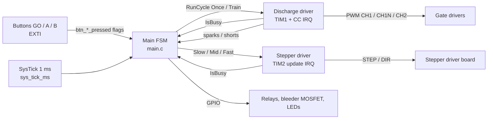
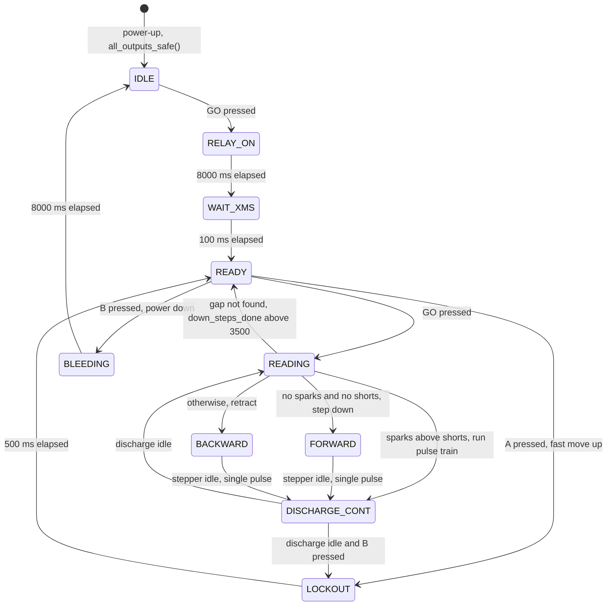
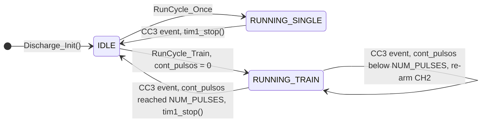
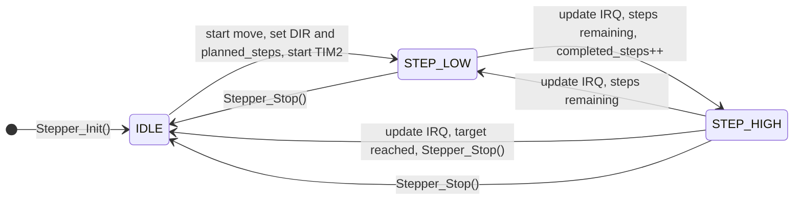
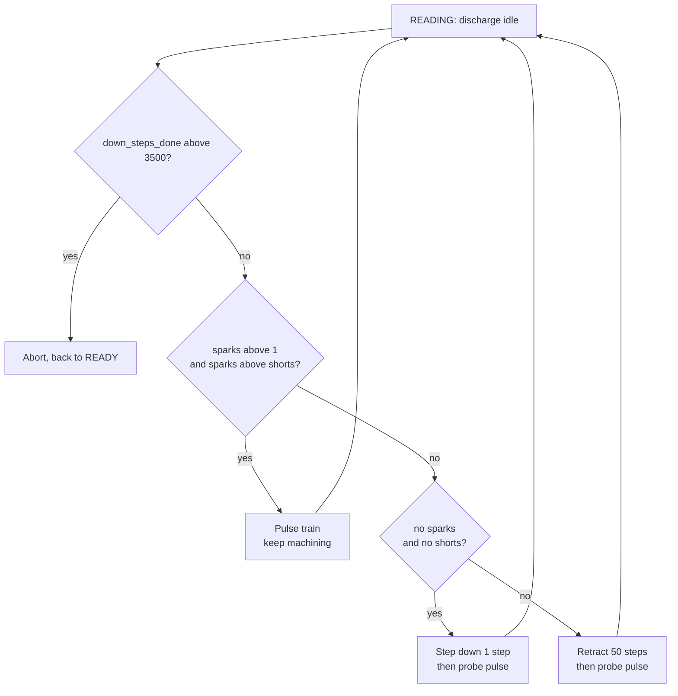

# D. Firmware & Control Logic 

Firmware documentation for the **STM32 Sinker EDM** controller: Keil uVision project structure, state machines, pulse-monitoring and gap-control logic, and safety/fault handling.

**Target:** STM32F103C8 ("Blue Pill") · **Toolchain:** Keil uVision (MDK-ARM) · **Code generation:** STM32CubeMX · **Peripheral drivers:** STM32 LL (Low-Layer) · **Core clock:** 72 MHz (8 MHz HSE + PLL ×9)

---

## Table of Contents

1. [Firmware Overview](#1-firmware-overview)
2. [Keil uVision Project Structure](#2-keil-uvision-project-structure)
3. [Hardware Resources & Interrupt Map](#3-hardware-resources--interrupt-map)
4. [Main State Machine](#4-main-state-machine)
5. [Discharge Driver (TIM1)](#5-discharge-driver-tim1)
6. [Stepper Driver (TIM2)](#6-stepper-driver-tim2)
7. [Pulse Monitoring & Gap Control](#7-pulse-monitoring--gap-control)
8. [Safety & Fault Handling](#8-safety--fault-handling)
9. [Debug & Test Hooks](#9-debug--test-hooks)
10. [Configuration Constants](#10-configuration-constants)
11. [Roadmap](#11-roadmap)

---

## 1. Firmware Overview

The firmware follows a **cooperative super-loop + interrupt-driven drivers** architecture:

- A **non-blocking finite state machine (FSM)** runs in `main()` and orchestrates the whole machine: capacitor charging, arming, gap approach, machining and safe shutdown. It never blocks; all waits are timestamp comparisons against a 1 ms SysTick counter (`sys_tick_ms`).
- Two **hardware-timed drivers** do the time-critical work in interrupts, so the FSM only starts them and polls their `IsBusy()` flags:
  - **Discharge driver** (TIM1): generates the complementary gate-drive pulses with microsecond resolution.
  - **Stepper driver** (TIM2): generates STEP pulses for the Z axis (electrode feed).
- **Push buttons** set event flags (`btn_go_pressed`, `btn_a_pressed`, `btn_b_pressed`); the FSM consumes and clears them.



---

## 2. Keil uVision Project Structure

The project was generated with STM32CubeMX and then reorganized so that **everything lives under the `MDK-ARM` folder, next to the `.uvprojx` project file**. The CubeMX project (`.ioc`) sits in the same place, so the hardware configuration and the firmware can be opened and regenerated from one location. Include paths in the Keil project options point to these folders, and the project builds with all modules resolving each other.

```text
MDK-ARM/
├── <project>.uvprojx          # Keil uVision project
├── <project>.ioc              # STM32CubeMX configuration (pins, clocks, peripherals)
├── Core/
│   ├── Inc/                   # main.h, discharge.h, stepper.h, global_vars.h, tim.h, adc.h, ...
│   └── Src/                   # main.c, discharge.c, stepper.c, tim.c, adc.c, ...
├── Drivers/
│   ├── CMSIS/                 # Core and device headers
│   └── STM32F1xx_HAL_Driver/  # LL driver headers and sources
└── Files/                     # Additional project files
```

### Application modules

| Module | Files | Responsibility |
|---|---|---|
| **Main FSM** | `main.c`, `main.h` | System init, clock tree, pin map, state machine, safe-state handling, error handler |
| **Discharge driver** | `discharge.c`, `discharge.h` | TIM1-based pulse generation (single pulse or pulse train), busy flag, CC interrupt handler |
| **Stepper driver** | `stepper.c`, `stepper.h` | TIM2-based STEP/DIR generation, three move profiles, busy flag |
| **Shared variables** | `global_vars.h` | Flags and counters shared between ISRs and the FSM (`sys_tick_ms`, `btn_*_pressed`, `sparks`, `shorts`, `I_Limit_Max`, `completed_steps`) |
| **Peripheral init** | `tim.c`, `adc.c`, `dma.c`, `gpio.c`, `usart.c` | CubeMX-generated initialization (TIM1, TIM2, TIM4, ADC1 + DMA, USART2, GPIO) |

### Code organization rules

- Application code is written inside the CubeMX `USER CODE BEGIN / END` blocks, so the `.ioc` can be modified and the code regenerated **without losing user code**.
- Constants that must survive regeneration (timing, pin aliases, FSM states) are defined inside `USER CODE BEGIN PD / PTD` in `main.h`.
- `static` helpers (LED, relay and MOSFET wrappers) are kept private to `main.c`; headers only expose the public API.
- Drivers expose a small, uniform API: `Init()`, one or more `Run...()` start functions, `IsBusy()` and an `IRQHandler()` called from the corresponding interrupt vector.

---

## 3. Hardware Resources & Interrupt Map

### Pin map

| Function | Pin | Notes |
|---|---|---|
| LED green | PB4 | Driven LOW = ON |
| LED red | PB3 | Driven LOW = ON |
| LED safe | PC13 | Driven LOW = ON (bleeding indicator) |
| Master relay | PB5 | Driven HIGH = ON |
| Charge relay | PB7 | Driven LOW = ON |
| Bleeder MOSFET | PB1 | Driven LOW = ON |
| Button GO | PA4 | External pull-up, active LOW, EXTI4 falling edge |
| Button A | PA15 | External pull-up, active LOW |
| Button B | PA10 | External pull-up, active LOW |
| TIM1_CH1 | PA8 | Discharge PWM |
| TIM1_CH1N | PB13 | Complementary discharge PWM |
| TIM1_CH2 | PA9 | Discharge PWM (second channel) |
| TIM1_BKIN | PB12 | Hardware break input (active LOW) |
| Stepper STEP | PA2 | Z-axis step pulse |
| Stepper DIR | PB10 | Z-axis direction (BAJA = LOW, SUBE = HIGH) |

PB3, PB4 and PA15 are freed from JTAG at start-up with `LL_GPIO_AF_Remap_SWJ_NOJTAG()` (SWD stays available for debugging).

### Timers

| Timer | Role | Resolution |
|---|---|---|
| SysTick | 1 ms system time base (`sys_tick_ms`) | 1 ms |
| TIM1 | Discharge pulses (PWM + compare events) | 1 µs per tick (prescaler 71) |
| TIM2 | Stepper step-rate timebase | 0.5 µs per tick (prescaler 35, with a 72 MHz timer clock) |

### Interrupt priorities

The NVIC uses **priority grouping 4** (4 bits of pre-emption, no sub-priority). A lower number means higher priority.

| Interrupt | Priority | Purpose |
|---|---|---|
| `TIM1_CC_IRQn` | 0 (highest) | Discharge pulse events (CC3, CC4): pulse timing is the most critical task |
| `TIM2_IRQn` | 5 | Stepper step generation |
| `SysTick_IRQn` | 15 (lowest) | 1 ms time base for the FSM |

---

## 4. Main State Machine

The main FSM lives in `main.c` and is implemented as a `switch (app_state)` inside the super-loop. Every state is non-blocking.



> `DISCHARGE_ONCE` also exists in the state enum (single pulse, then back to `READING`). It is only reachable through a commented-out debug path and is not part of the normal flow.

### State descriptions

| State | Indicators | Behavior | Exit condition |
|---|---|---|---|
| **IDLE** | Green LED blinks (500 ms) | Relays off, waiting for the operator | `btn_go_pressed` → `RELAY_ON` |
| **RELAY_ON** | Red LED steady | Master and charge relays ON, bleeder OFF; capacitors charge | 8 s elapsed (`TIME_RELAY_WAIT_MS`) |
| **WAIT_XMS** | Red LED steady | Charge relay released; buttons ignored | 100 ms elapsed (`TIME_RELAY_DEL_WAIT_MS`) |
| **READY** | Green LED steady | Machine armed; `sparks` and `shorts` cleared every pass | GO → `READING`, A → `LOCKOUT`, B → `BLEEDING` |
| **READING** | Both LEDs on | Decision state: waits for the discharge driver to be idle, then evaluates `sparks` / `shorts` (see [section 7](#7-pulse-monitoring--gap-control)) | One of four outcomes |
| **FORWARD** | – | Waits for the stepper to finish a downward move, then fires a single discharge | Stepper idle → `DISCHARGE_CONT` |
| **BACKWARD** | – | Waits for the stepper to finish an upward move, then fires a single discharge | Stepper idle → `DISCHARGE_CONT` |
| **DISCHARGE_CONT** | LEDs off | Pulse train or single discharge running | Driver idle: B pressed → `LOCKOUT`, else → `READING` |
| **BLEEDING** | Safe LED blinks (200 ms) | Master relay off; after 100 ms the bleeder MOSFET turns on; buttons ignored | 8 s elapsed (`TIME_BLEEDING_WAIT_MS`) → `IDLE` |
| **LOCKOUT** | Red LED blinks (200 ms) | Short forced pause; `I_Limit_Max` cleared; buttons ignored | 500 ms elapsed (`TIME_LOCKOUT_MS`) → `READY` |
| **default** | – | Unknown state: `all_outputs_safe()` and restart from `IDLE` | Immediate |

### Operator interface

| Button | In `READY` | In `DISCHARGE_CONT` | Other states |
|---|---|---|---|
| **GO** | Start automatic machining | – | `IDLE`: start charging. Ignored elsewhere |
| **A** | Fast move up, then lockout | – | Ignored |
| **B** | Controlled power-down (bleeding) | Stop machining → `LOCKOUT` | Ignored |

Button flags are explicitly cleared in states where input must not be latched (`WAIT_XMS`, `BLEEDING`, `LOCKOUT`), so a press made during a non-interactive phase can never trigger an action later.

---

## 5. Discharge Driver (TIM1)

**Files:** `discharge.c`, `discharge.h`

The driver turns TIM1 into a small, self-stopping pulse generator. The FSM calls a `RunCycle` function and then polls `Discharge_IsBusy()`; everything in between happens in the `TIM1_CC` interrupt.

### Pulse shape

One pulse is defined by four compare values, with 1 tick = 1 µs:

| Parameter | Define | Value | Meaning |
|---|---|---|---|
| ARR | `T_TOTAL_US` | 60 | Total pulse length (about 60 µs) |
| CCR1 | `T_CH1_TO_LOW_US` | 23 | CH1 is HIGH until this tick (PWM1 mode); CH1N is its complement with dead-time |
| CCR2 | `T_CH2_TO_HIGH_US` | 11 | CH2 goes HIGH at this tick (active-on-match mode) |
| CCR4 | `T_CH2_TO_LOW_US` | 50 | ISR forces CH2 LOW at this tick |
| CCR3 | `T_TOTAL_US - 1` | 59 | End-of-pulse event, one tick before the update event |

```text
 tick   0          11         23                 50      59  60
 CH1    ############################|_____________________________
 CH1N   (complement of CH1, separated by dead-time)
 CH2    ___________|###########################|__________________
 CC3                                                        ^  end-of-pulse event
```

### Cycle types

| Function | Type | Behavior |
|---|---|---|
| `Discharge_RunCycle_Once()` | Single pulse | One pulse, then the timer stops and the driver goes idle |
| `Discharge_RunCycle_Train()` | Pulse train | `NUM_PULSES` (8) back-to-back pulses, then stop |

### Driver state machine



### Interrupt-driven pulse control

- **CC4 event (tick 50):** the ISR switches CH2 to `FORCED_INACTIVE`. This is needed because in "active on match" mode the output goes HIGH on a compare match but never returns LOW by itself.
- **CC3 event (tick 59):** the ISR ends the pulse.
  - Single pulse, or last pulse of a train: `tim1_stop()` and `dis_busy = 0`.
  - Otherwise: CH2 is switched back to `OCMODE_ACTIVE` (**re-arm**) and the counter wraps to start the next pulse. Without this step, CH2 would stay in forced-inactive mode and never fire again.
- `tim1_stop()` always leaves the timer safe: counter disabled, compare interrupts and flags cleared, CH2 re-armed, and **MOE = 0** so the outputs return to their configured idle levels.
- `Discharge_Init()` loads all compare registers with `65535` (greater than ARR) so no output can go active before the first cycle is requested.

---

## 6. Stepper Driver (TIM2)

**Files:** `stepper.c`, `stepper.h`

The Z axis (electrode feed) is driven by STEP/DIR pulses generated entirely from the TIM2 update interrupt. The FSM only requests a move and polls `Stepper_IsBusy()`.

### Move profiles

| Function | Steps | Approx. duration | Used for |
|---|---|---|---|
| `Stepper_Mov_Slow(dir)` | `NUM_APROX_STEPS` = 1 | ≈ 0.3 ms | Fine approach towards the workpiece |
| `Stepper_Mov_Mid(dir)` | `NUM_STEPS_MID` = 50 | ≈ 15 ms | Retract after short circuits |
| `Stepper_Mov_Rapido(dir)` | `NUM_QUICK_STEPS` = 35000 | ≈ 10.5 s | Fast travel (button A) |

Direction constants: `BAJA` (0) moves down, `SUBE` (1) moves up. `TIME_BETWEEN_STEPS` (300 ticks) sets the time per STEP phase: about 150 µs per phase, 300 µs per full step (≈ 3.3 kHz).

### Driver state machine

One full step takes two interrupts: a rising edge (counted as a step) and a falling edge.



- A new move request is **ignored while the driver is busy** (the function returns 1).
- `Stepper_Stop()` can be called at any time: it disables TIM2, forces STEP low and clears the internal counters. The same function is used automatically when a move completes.

---

## 7. Pulse Monitoring & Gap Control

The quality of the spark gap is evaluated **per discharge cycle** using two counters shared with the FSM:

| Variable | Meaning |
|---|---|
| `sparks` | Number of effective sparks counted in the last cycle |
| `shorts` | Number of short-circuit events counted in the last cycle |
| `I_Limit_Max` | Over-current limit counter, cleared in `LOCKOUT` |

The counters are reset to zero in `READY` and after every decision, so each evaluation only reflects the cycle that just finished.

### Decision logic (`STATE_READING`)

Once the discharge driver is idle, the FSM evaluates the counters in this priority order:

| # | Condition | Action | Next state |
|---|---|---|---|
| 1 | `down_steps_done > 3500` | Gap not found after too many approach steps: abort and clear counters | `READY` |
| 2 | `sparks > 1` **and** `sparks > shorts` | Good machining condition: run a pulse train (`NUM_PULSES`) | `DISCHARGE_CONT` |
| 3 | `sparks < 1` **and** `shorts < 1` | Gap too open: advance 1 step down (`BAJA`), `down_steps_done++` | `FORWARD` |
| 4 | Otherwise (shorts dominate) | Gap too small: retract 50 steps (`SUBE`), `down_steps_done = 0` | `BACKWARD` |

After a move (`FORWARD` / `BACKWARD`) the FSM fires a **single probe pulse** and re-evaluates. This produces a closed-loop behavior:



In practice the electrode creeps towards the workpiece one step at a time while the gap is open, backs off when short circuits dominate, and stays put (pulsing) while the spark count is healthy (how is evaluated is addressed ahead).


---

## 8. Safety & Fault Handling

The machine stores energy in capacitors, so the firmware is organized around one rule: **every path ends in a known safe state.**

| Hazard | Mitigation |
|---|---|
| Undefined outputs at start-up | `all_outputs_safe()` runs before any driver is initialized: LEDs off, master relay off, bleeder MOSFET on |
| Unsafe timer outputs | `Discharge_Init()` loads compare values above ARR so no channel can go active; `tim1_stop()` clears **MOE** so the outputs return to their configured idle levels |
| Shoot-through on complementary outputs | CH1 / CH1N are complementary with hardware **dead-time** (`DeadTime` = 76, about 1.06 µs) |
| External fault on the power stage | TIM1 **break input** (PB12, active LOW) is enabled with `OSSI` / `OSSR`; automatic output re-enable is disabled, so outputs only restart through software |
| Overlapping cycles | Discharge and stepper drivers ignore new requests while busy |
| Premature operation after power-up | Capacitors charge for 8 s, then the charge relay is released and a 100 ms settling time is enforced before `READY`; buttons are ignored during this phase |
| Stored energy after shutdown | `BLEEDING` state: master relay off, 100 ms later the bleeder MOSFET turns on, safe LED blinks for 8 s, and the machine returns to `IDLE` only afterwards |
| Operator stop during machining | Button B during `DISCHARGE_CONT` ends the sequence once the current (sub-millisecond) cycle completes and enters `LOCKOUT` |
| Endless gap search | Automatic abort to `READY` after 3500 (NUMBER_STEPS_DOWN_MAX) consecutive approach steps without finding the gap |
| Accidental or latched inputs | Button flags are cleared in every state that must not react to them |
| Over-current events | `I_Limit_Max` counter is cleared in `LOCKOUT` before machining resumes |
| Corrupted or unknown FSM state | `default` branch calls `all_outputs_safe()` and restarts from `IDLE` |
| Unrecoverable error | `Error_Handler()` disables all interrupts, forces safe outputs and halts in an infinite loop |

---

## 9. Debug & Test Hooks

The source keeps a few **commented-out blocks marked `DEBUG`**. They are not needed for normal operation; they were used during bring-up and bench testing and can be removed or re-enabled:

| Item | Purpose |
|---|---|
| `tren`, `sparks_effective`, `sparks_ineffective`, `test_start_ms`, `test_elapsed_ms` | Counters for spark-efficiency tests |
| `TARGET_SPARKS` (10000) | Stop condition for timed spark-count tests |
| `STATE_DISCHARGE_ONCE` | Single-pulse state for isolated pulse testing |
| `Discharge_RunCycle_Train()` in `STATE_READY` | Approach test without electrolysis |
| Alternate STEP/DIR pins (PB0 / PA7) in `stepper.c` | Test of a second driver on another axis |

---

## 10. Configuration Constants

| Constant | File | Value | Description |
|---|---|---|---|
| `TIME_RELAY_WAIT_MS` | `main.h` | 8000 | Capacitor charge time |
| `TIME_RELAY_DEL_WAIT_MS` | `main.h` | 100 | Settling time after relay release / before bleeder |
| `TIME_LOCKOUT_MS` | `main.h` | 500 | Lockout duration |
| `TIME_BLEEDING_WAIT_MS` | `main.h` | 8000 | Total bleeding time |
| `TIME_BLINK_IDLE_MS` | `main.h` | 500 | Green LED blink period in `IDLE` |
| `TIME_BLINK_LOCKOUT_MS` | `main.h` | 200 | Red / safe LED blink period |
| `NUMBER_STEPS_DOWN_MAX` | `main.h` | 35000 | steps |
| `T_TOTAL_US` | `discharge.h` | 60 | Pulse length (µs) |
| `T_CH1_TO_LOW_US` | `discharge.h` | 23 | CH1 HIGH time (µs) |
| `T_CH2_TO_HIGH_US` | `discharge.h` | 11 | CH2 start (µs) |
| `T_CH2_TO_LOW_US` | `discharge.h` | 50 | CH2 end (µs) |
| `NUM_PULSES` | `discharge.h` | 8 | Pulses per train |
| `NUM_APROX_STEPS` | `stepper.h` | 1 | Fine approach steps |
| `NUM_STEPS_MID` | `stepper.h` | 50 | Retract steps |
| `NUM_QUICK_STEPS` | `stepper.h` | 35000 | Fast move steps |
| `TIME_BETWEEN_STEPS` | `stepper.h` | 300 | TIM2 ticks per STEP phase |


---

## 11. Roadmap

- Add an abort path for the fast move (call `Stepper_Stop()` from a button or fault event).
- Unify return codes and naming between the discharge and stepper driver APIs.
- Add an independent watchdog (IWDG) to the main loop.
- Log machining statistics (spark counts, efficiency, elapsed time) over USART2.
