# E. Experimental Results & Oscilloscope Captures

[⬅️ Back to Main](..)

---

## E. Experimental Results & Oscilloscope Captures

### 1. Cutting Tests & Material Removal Rate (MRR)

To evaluate the machining performance of the sinker EDM prototype, three cutting trials were conducted across different workpiece materials (aluminum and structural steel) and step-control algorithms. Cavity surface areas were optically measured using **ImageJ** calibrated against a known dimensional reference, and total removed volume was calculated from the resulting ticknes of the material.

#### Cutting Parameters & Results Summary

| test                                 | voltage (V) | t_on (us) | t_off (us) | algorithm       | short current (A) | current spark peak (A) | time (mins) | MRR (mm3/min) |
|:------------------------------------:|:-----------:|:---------:|:----------:|:---------------:|:-----------------:|:----------------------:|:-----------:|:-------------:|
| aluminum                             | 156.7       | 39        | 22         | HIGH Duty Cycle | 30                | 20                     | 5           | 4.31          |
| structural steel (direct polarity)   | 156.7       | 39        | 22         | LOW Duty Cycle  | 40                | 34                     | 180         | 0.03          |
| structural steel (inverted polarity) | 156.7       | 39        | 22         | LOW Duty Cycle  | 40                | 34                     | 180         | 0.12          |

---

#### Impact of Step-Control Strategy & Workpiece Material on MRR

A drastic drop in Material Removal Rate—from **4.30 $\text{mm}^3/\text{min}$** down to **0.12 $\text{mm}^3/\text{min}$**—was observed between the initial and subsequent trials. This reduction is driven by two compounding factors:

1. **Mechanical Step-Control Overhead (Firmware Sequence):**
   *(Stepper resolution: $12,800\text{ microsteps} = 2\text{ mm} \rightarrow 0.15625\ \mu\text{m/step}$)*
   * **Initial Algorithm (HIGH Duty Cycle):** The electrode advanced 1 microstep and triggered a 4-pulse burst. If a short circuit was detected, it retracted by just **1 microstep**, fired another 4-pulse burst, and evaluated the spark-to-short ratio. It continued stepping back 1 microstep at a time only until valid sparks outnumbered short circuits. This kept the electrode hovering tightly within the ionization gap, maximizing active spark time.
   * **Modified Algorithm (LOW Duty Cycle):** Upon detecting a short circuit, the firmware was modified to execute an immediate **50-microstep retraction (~7.8 $\mu\text{m}$)** without pulsing, followed by a single-step, single-pulse probing advance until valid sparks outnumbered shorts (at which point an 8-pulse machining burst was enabled). While this effectively cleared debris and prevented prolonged arcing, traversing 50 microsteps back and forth at single-pulse intervals introduced massive mechanical dead time, starving the gap of discharge energy.

2. **Workpiece Thermal & Physical Properties:**
   * **Aluminum vs. Structural Steel:** Aluminum has a significantly lower melting point ($\approx 660\ ^\circ\text{C}$) and lower latent heat of fusion compared to structural steel ($\approx 1,425 - 1,540\ ^\circ\text{C}$). Steel requires substantially higher thermal energy density per spark to melt and eject material, naturally yielding a much lower MRR even under optimal gap control.

---

#### Optical Area Measurement Methodology (ImageJ)

To accurately quantify the eroded cavity volume without relying solely on tool-tip geometry, top-down macro photographs of the machined craters were processed in **ImageJ**:

1. **Spatial Calibration:** A physical reference (machined feature or millimeter scale in the focal plane) was used to set the pixel-to-millimeter ratio (`Analyze > Set Scale`).
2. **Contour & Thresholding:** The eroded boundary was isolated using polygon selection / color thresholding to measure the exact projected area ($\text{mm}^2$).
3. **Volume Estimation:** $\text{Volume} = \text{Measured Area} \times \text{thickness of piece}$.

  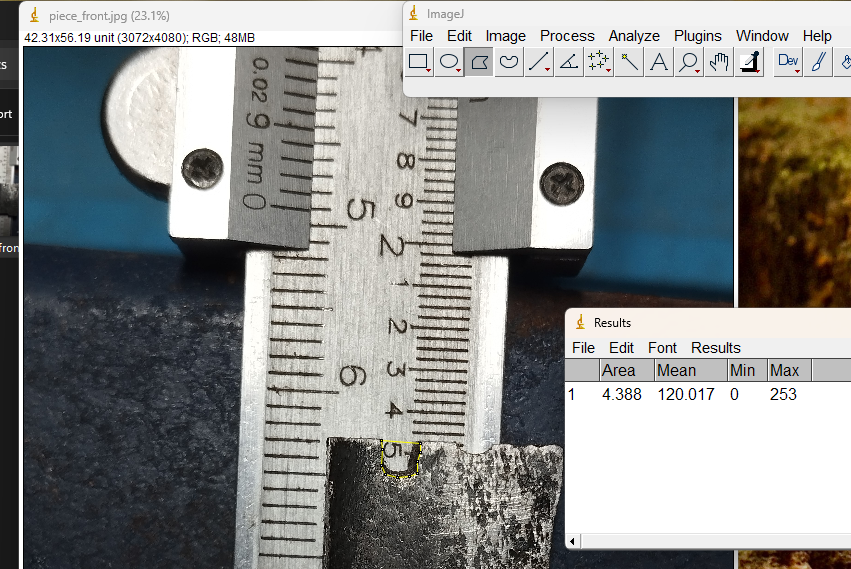

<i>Figure 1: Example of cavity surface area measurement in ImageJ showing scale calibration and eroded boundary selection.</i>

---

### 2. Oscilloscope Captures & Waveform Analysis

All experimental measurements were acquired using a 2-channel oscilloscope. To maintain a consistent phase and timing reference across sequential single-channel captures, **Oscilloscope Channel 1 (CH1)** was anchored to the **high-side of the spark gap** (used as the primary trigger source), while **Channel 2 (CH2)** probed the respective gate-drive, logic, step-pulse, and current-sense nodes.

---

#### 2.1 Theoretical Switching Sequence & Gate Drive Timing

Before inspecting physical hardware waveforms, the diagram below illustrates the intended switching sequence for the power stage channels (**CH1**, **CH1N**, and **CH2**) alongside the theoretical gap current profile, highlighting the ignition phase and peak discharge current:

  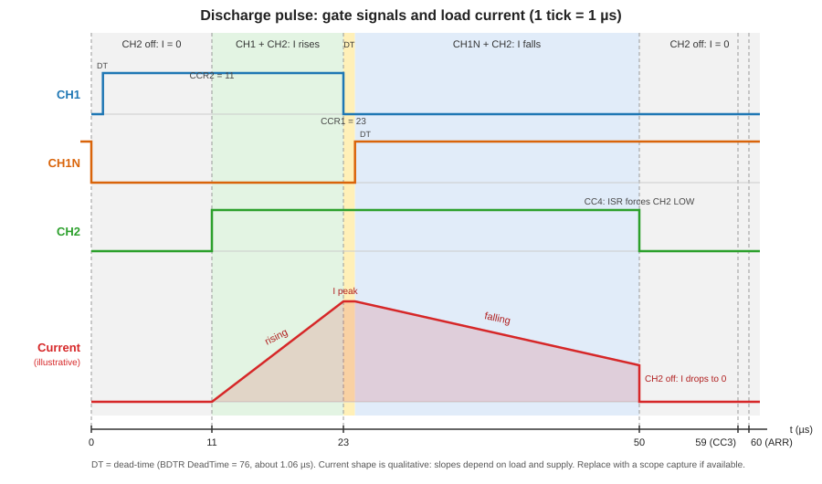
   
  <em>Figure 2: Theoretical timing diagram of CH1, CH1N, and CH2 gate signals and resulting discharge current peak.</em>

##### IGBT Gate Drive Signals & Spark Discharge Capture

Using the high-side gap voltage as the trigger reference (CH1), the physical gate-drive signals were measured directly at the respective IGBT gates (CH2), followed by a capture of an active spark discharge event:

<table>
  <tr>
    <td align="center" width="50%">
      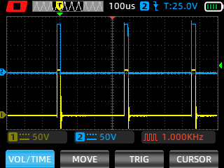
       
      <b>(a) CH1 Gate Signal</b> 
      High-side gap reference (CH1) vs. CH1 IGBT gate drive (CH2).
    </td>
    <td align="center" width="50%">
      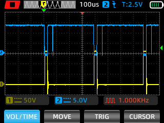
       
      <b>(b) CH1N Gate Signal</b> 
      High-side gap reference (CH1) vs. complementary CH1N gate drive (CH2).
    </td>
  </tr>
  <tr>
    <td align="center" width="50%">
      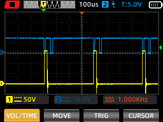
       
      <b>(c) CH2 Gate Signal</b> 
      High-side gap reference (CH1) vs. discharge switch CH2 gate drive (CH2).
    </td>
    <td align="center" width="50%">
      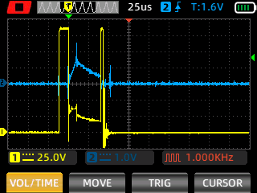
       
      <b>(d) Active Spark Discharge</b> 
      Gap voltage rises upon CH1 turn-on; midway, CH2 triggers ignition, collapsing gap voltage as discharge current ramps up.
    </td>
  </tr>
</table>

* **Discharge Dynamics:** As seen in **(d)**, activating **CH1** establishes the open-circuit voltage across the gap. At the midpoint of the cycle, **CH2** turns on to initiate dielectric breakdown—causing the gap voltage to drop sharply to the arc-burning voltage while discharge current surges.

---

#### 2.2 Stepper Control & Gap-Seeking Firmware Sequences

To validate the real-time interaction between spark detection and Z-axis motion control, **CH1** remained on the high-side gap reference while **CH2** monitored the microcontroller's **STEP** output pin sent to the stepper driver.

##### Workpiece Approach / Seeking Algorithm

<table>
  <tr>
    <td align="center" width="50%">
      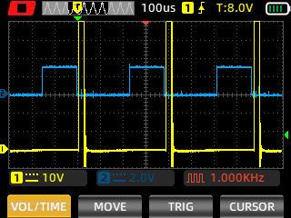
       
      <b>(a) Single-Step Probing Detail</b> 
      Zoomed view showing a single STEP pulse synchronized with open-circuit discharge probing.
    </td>
    <td align="center" width="50%">
      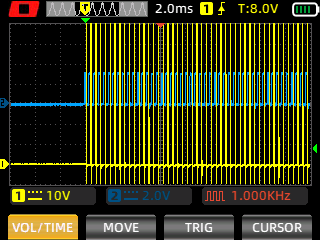
       
      <b>(b) Pulse Train Zoom-Out</b> 
      Macro view of continuous approach pulse trains executing until gap ionization is detected.
    </td>
  </tr>
</table>

##### Short-Circuit Detection & Retraction Algorithm

<table>
  <tr>
    <td align="center" width="50%">
      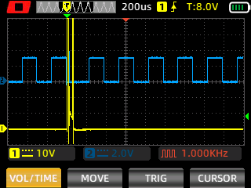
       
      <b>(a) Short-Circuit Reaction Detail</b> 
      When lecture read shorts>sparks the firmware's STEP retraction sequence.
    </td>
    <td align="center" width="50%">
      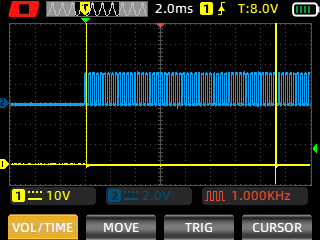
       
      <b>(b) Retraction Pulse Train Zoom-Out</b> 
      Multi-step retraction burst executed to clear debris and restore open-circuit gap isolation.
    </td>
  </tr>
</table>

---

#### 2.3 Comparator Output & Switching Noise Analysis

The hardware discriminator uses dedicated comparator outputs routed to separate MCU input pins to distinguish between a valid **Spark** and a **Short Circuit**. Although both comparator channels exhibit identical electrical pulse topologies when triggered, high-frequency switching transients introduce noise spikes that can cause false positives on either line.

<table>
  <tr>
    <td align="center" width="50%">
      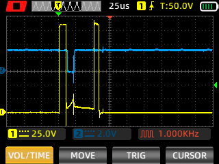
       
      <b>(a) Detector Output Pulse</b> 
      Logic transition generated by the short/spark comparator stage during a gap event.
    </td>
    <td align="center" width="50%">
      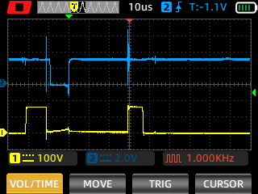
       
      <b>(b) High-Frequency Noise Detail</b> 
      Zoomed view revealing switching-induced glitches capable of triggering false positive readings on both MCU sense pins.
    </td>
  </tr>
</table>

---

#### 2.4 Gap State Comparison: Open Circuit vs. Short vs. Spark

Side-by-side comparison of the three fundamental operating states observed at the gap under identical trigger and scaling settings:

<table>
  <tr>
    <td align="center" width="33.3%">
      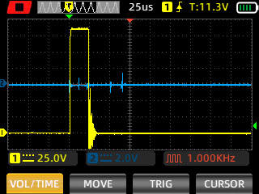
       
      <b>(a) Open Circuit (No Gap Contact)</b> 
      Full open-circuit voltage sustained throughout the $T_{on}$ window with zero breakdown current.
    </td>
    <td align="center" width="33.3%">
      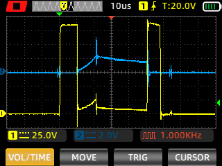
       
      <b>(b) Short Circuit</b> 
      Immediate voltage collapse to near $0\text{ V}$ at the start of $T_{on}$ without an ionization delay.
    </td>
    <td align="center" width="33.3%">
      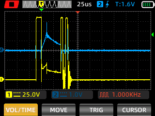
       
      <b>(c) Valid Spark Discharge</b> 
      Initial open-circuit plateau followed by mid-pulse dielectric breakdown and sustained arc voltage.
    </td>
  </tr>
</table>

---

#### 2.5 Current Sense Filtering, BKIN Limitations & DC Bus Transient Absorption

To monitor discharge current and protect the power stage, the current-sense signal passes through a resistive voltage divider followed by an analog RC low-pass filter:

<table>
  <tr>
    <td align="center" width="33%">
      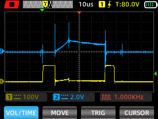
       
      <b>(a) Raw Current Sense (Voltage Divider)</b> 
      Unfiltered current waveform showing severe turn-on/turn-off switching spikes.
    </td>
    <td align="center" width="33%">
      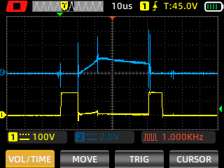
       
      <b>(b) Post-Filter Current Signal & Bus Stability</b> 
      Filtered waveform showing fail to limit spikes under high-current discharge.
    </td>
    <td align="center" width="33%">
      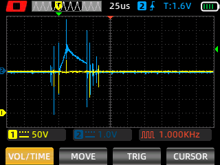
       
      <b>(b) Bus Overvoltage Stability</b> 
      Waveform showing spikes under high-current discharge under limits.
    </td>
  </tr>
</table>

* **STM32 `BKIN` Hardware Break Limitation:** Even after analog filtering, residual switching spikes remain visible at the comparator/MCU input **(b)**. Because the STM32 timer Break Input (`BKIN`) reacts asynchronously within nanoseconds, these residual transients would cause nuisance trips (false positives), preventing direct hardware `BKIN` shutdown without additional blanking circuitry.
* **DC Bus Overvoltage Margin ($156.7\text{ V}$ vs. $200\text{ V}$):** Under high-current discharge conditions, inductive flyback and switching transients do not produce hazardous voltage spikes on the main DC link. The voltage headroom between the nominal **$156.7\text{ V}$** operating bus and the **$200\text{ V}$** capacitor rating safely absorbs inductive energy without stressing the bus capacitors, remembering the shunt resistance of 50mOhm it can be seen a good behavior at 40A currents.

---

#### 2.6 High-Voltage Capacitor Bank Charge & Controlled Bleeding Discharge

For operational safety after power-down, the main DC bus capacitor bank is discharged through a power bleeding resistor switched via relays:

<table>
  <tr>
    <td align="center" width="50%">
      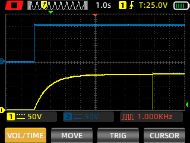
       
      <b>(a) Controlled Capacitor Bank Charge</b> 
      Bus voltage ramp-up to the nominal $156.7\text{ V}$ operating level.
    </td>
    <td align="center" width="50%">
      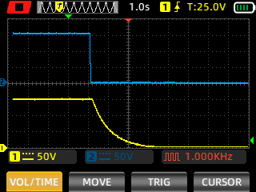
       
      <b>(b) Relay-Switched Bleeding Discharge</b> 
      Exponential voltage decay across the bleeding resistor upon relay activation.
    </td>
  </tr>
</table>

* **Current Implementation & Future Improvement:** Currently, the bleeding relay is actuated via a **fixed time-delay sequence** once machining stops. While functional, migrating to closed-loop feedback using a **resistor voltage divider** tied to an STM32 ADC channel is planned for future revisions to actively verify safe bus voltage levels ($< 24\text{ V}$) before allowing user access.

[⬅️ Back to Main](..)
