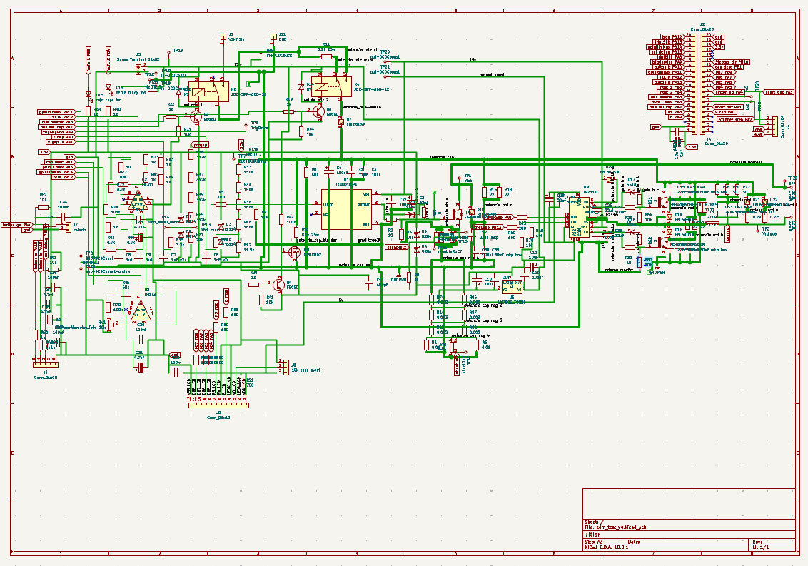
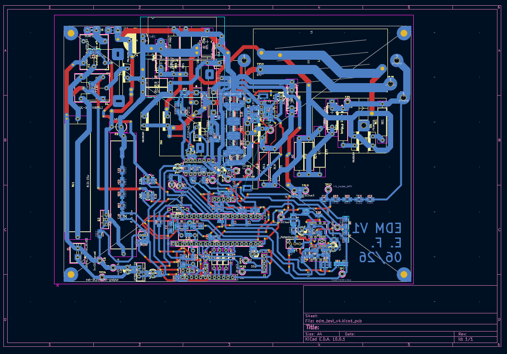
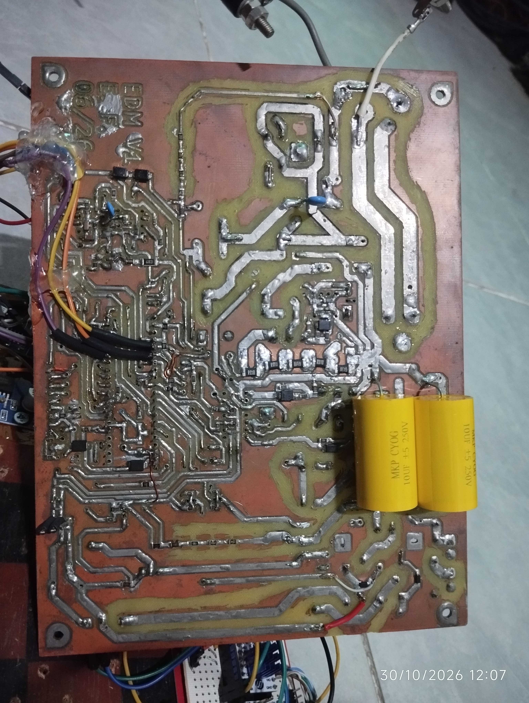
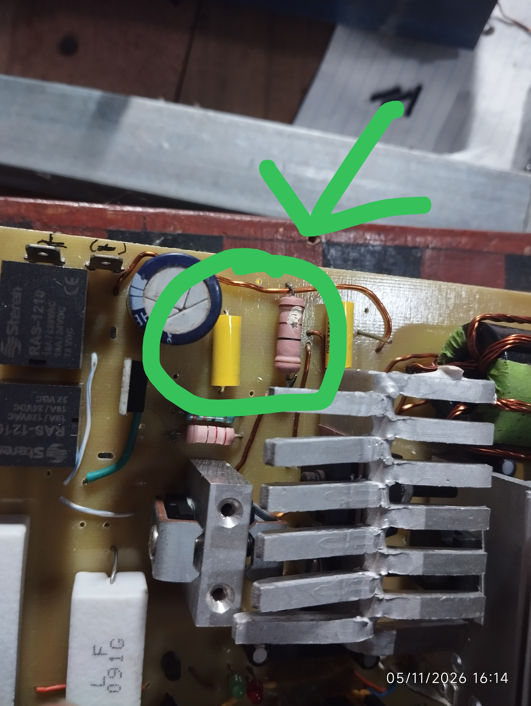
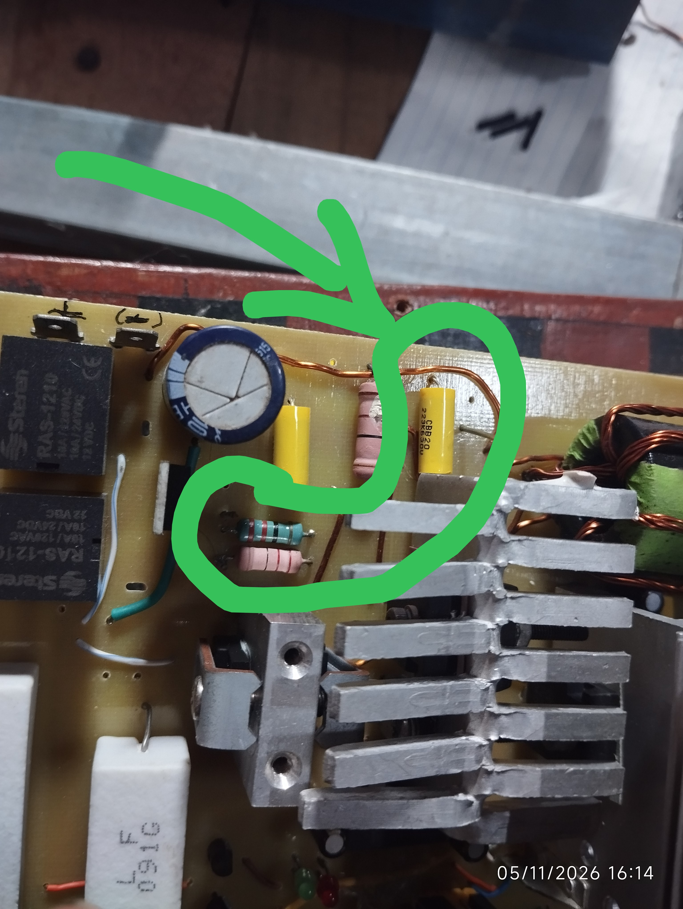
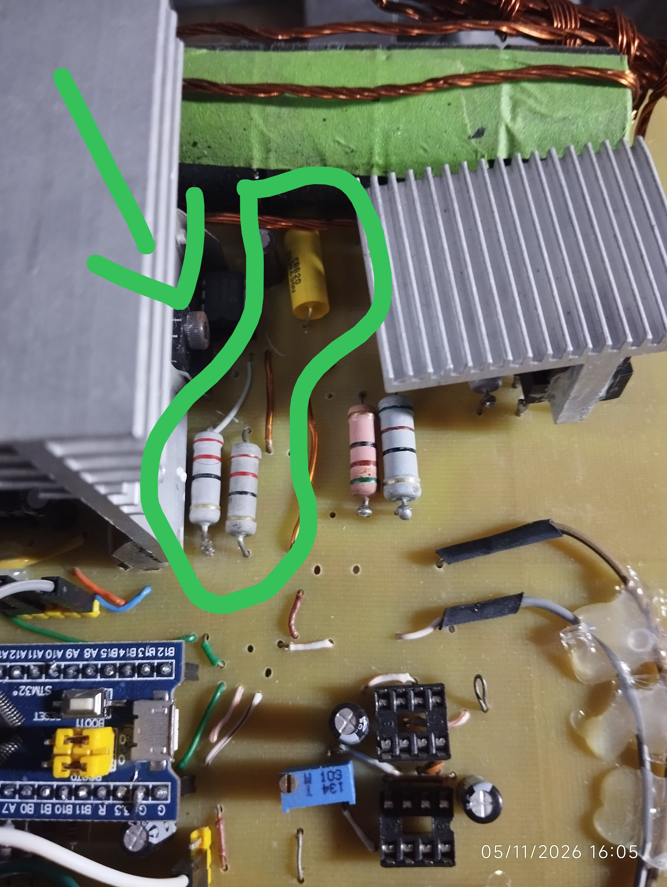
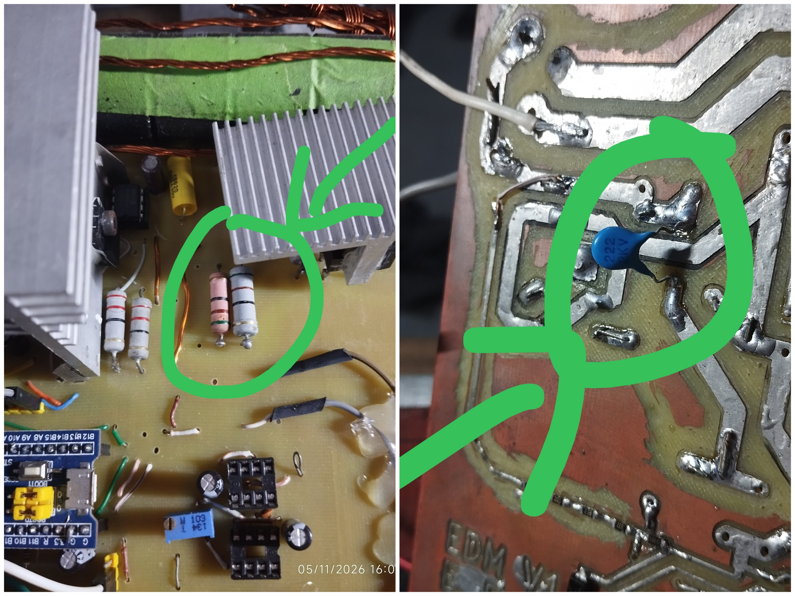
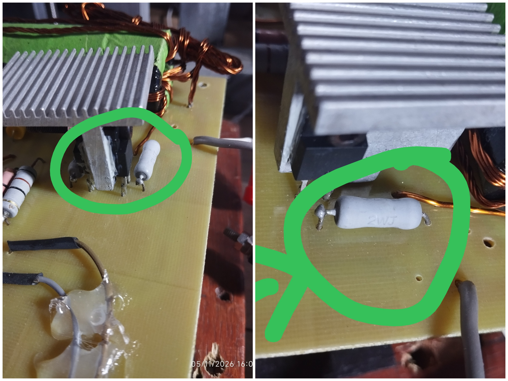
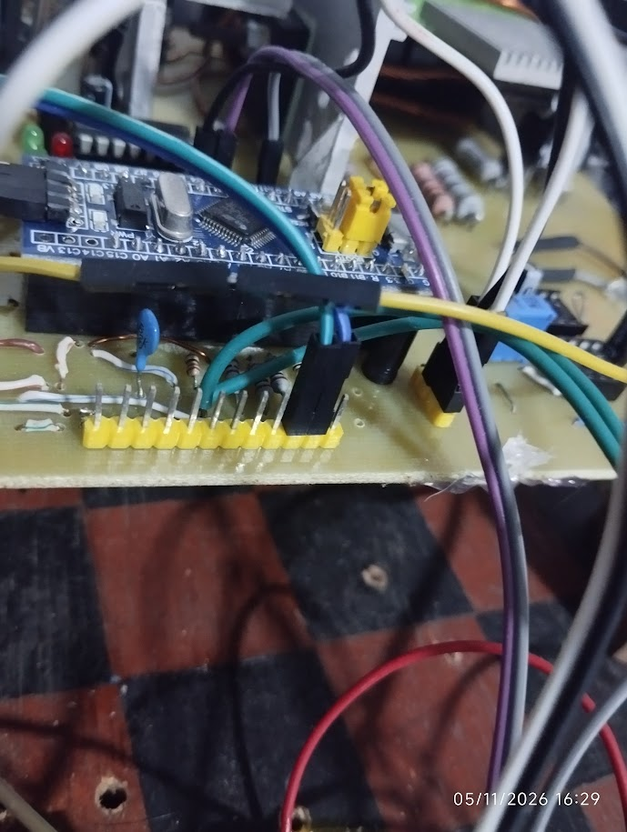

# C. Hardware & Bill of Materials (BOM)

[⬅️ Back to Main](..)

---

## 1. KiCad Schematics & Single-Sided PCB Layout
This section covers the electronic design files for the main control and power boards. 

> ⚠️ **Prototyping Philosophy & "As-Is" Reality Check:**  
> This was one of the first custom PCB designs I undertook. Given manufacturing lead times and variables, making a second "perfect" iteration without knowing whether the core concept would work was economically and temporally unviable. The primary goal was a **Proof of Concept (PoC)** to validate simulations in the physical world. Consequently, several improvised modifications and design adjustments were made on the fly, which are detailed below.

<!-- Espacio para la captura del Esquemático -->

  

<i>Figure 1: Main schematic overview designed in KiCad.</i>

<!-- Espacio para la captura del PCB Layout -->

  

<i>Figure 2: Single-sided PCB layout showing traces, via placements, and routing.</i>

---

## 2. On-the-Fly PCB Modifications & Practical Workarounds
Because hardware validation happened iteratively, several physical modifications were implemented directly on the manufactured board:

- **Via Patching & Pin Re-routing:** Manual via jumpers were soldered to correctly map switching nodes to the required STM32 timer pins (`t1c1` and `t1c1n`).
- **Snubber Circuit Adaptability:** All snubber networks in the schematic were intentionally designed with footprints for **3 parallel capacitors and 3 parallel resistors**. This multi-footprint approach was chosen to handle resource constraints and future-proof the board; if initial bench tests required different capacitance or resistance values, alternative components from inventory could be dropped straight into the existing pads and vias without redesigning the PCB.
- **Snubber Tuning (Empirical Result):** Initial testing revealed that a snubber resistor was running excessively hot. The capacitance was subsequently decreased, and the resistance value was doubled to stabilize thermal performance.
- **LM311 Comparators on Main PCB:** While LM311 comparators were provisioned directly on the main PCB layout, they **were ultimately bypassed / left unused** due to high-frequency noise interference (further discussed in the experimental results section).
- **Direct Wire Jumpering:** Hardwired jumper wires were soldered directly to specific STM32 pins to bypass routing constraints.
- **Header Re-purposing for Alternative I/O:** Pins originally allocated for a standard LCD screen (which was dropped in favor of the 3-button layout) were re-purposed as additional **I/O control lines** by soldering direct wires to the physical pin headers.
- **Diode Current-Balancing Resistors:** For the gap spark-extinction path, two recycled ultrafast diodes were wired in **parallel**. To compensate for slight voltage-drop and characteristic disparities between recycled components, **balancing resistors** (specifically selected as close matching values of **0.22Ω and 0.24Ω** with a plain gray body finish) were integrated to ensure even current sharing across the diode bank.
- **Current Shunt Resistor Modification:** The SMD current shunt configuration was modified by adjusting the quantity and series/parallel arrangement of resistors. It was transitioned from an initial target of **$10\text{ m}\Omega$** to approximately **$50\text{ m}\Omega$** (using an arrangement of 5 elements). This 5x increase in resistance scaled up the voltage drop across the shunt, significantly improving signal amplitude and readability for an economical, lower-sensitivity handheld oscilloscope. While this introduces a minor trade-off in insertion impedance, it provides a practical, clear approximation of current flow and a healthy margin for signal capture during testing.

  

<i>Figure 3: PCB with corrections and on the fly modifications.</i>

---

## 3. Hardware Detail Galleries (As-Built Modifications)

Here are detailed close-ups of the physical modifications, snubber builds, balancing components, and wiring workarounds implemented on the board:

<!-- Foto de Detalle 1: Snubber 1 -->

  

<i>Figure 4: Detail of Snubber Network #1 layout and multi-component footprint usage, for SW1(Q6).</i>

<!-- Foto de Detalle 2: Snubber 2 -->

  

<i>Figure 5: Detail of Snubber Network #2 layout and multi-component footprint usage, for SW2(Q7).</i>

<!-- Foto de Detalle 3: Snubber 3 -->

  

<i>Figure 6: Detail of Snubber Network #3 layout and multi-component footprint usage, for SW3(Q1).</i>

<!-- Foto de Detalle 4: Snubber 4 -->

  

<i>Figure 7: Detail of Snubber Network #4 tuning and thermal adjustments, for extinguishing Diodes(D21, D22).</i>

<!-- Foto de Detalle 5: Resistencias de balanceo -->

  

<i>Figure 8: Parallel ultrafast diodes with 0.22Ω and 0.24Ω plain gray balancing resistors.</i>

<!-- Foto de Detalle 6: Headers reutilizados -->

  

<i>Figure 9: Reused LCD pin headers wired as alternative control I/O lines.</i>

---

## 4. Key Bill of Materials (BOM) & Component Choices
Most components were selected based on local availability in Central America or recycling channels:

| Component Category | Description / Source | Notes & Adaptations |
| :--- | :--- | :--- |
| **Power Switches (IGBTs / MOSFETs)** | Sourced via Temu / Salvaged | Selected for built-in flyback diodes, simplifying high-current protection without requiring heavy external diodes. |
| **Energy Storage Capacitors** | MKP (10uF & 22nF both >= 250V) / pulse capacitors (Sourced via Amazon) | Used for the primary high-voltage pulse discharge bank and snubbers. Alternative capacitor types can be experimented with. |
| **Power Supply** | 3x Telecom power units (-50VDC each) | Recycled from local scrap electronics, wired in series to supply the high-voltage rail. |
| **Actuators & Mechanics** | NEMA 17 Stepper Motors + Linear Rail | Recycled from local scrap electronics/hardware repurposed to drive the Z-axis electrode feed. |
| **Heatsinks** | Salvaged / Oversized | Sourced from whatever was available in the workshop. They are intentionally **oversized** for the current low-frequency operating envelope, but future-proofed for higher switching frequencies where thermal accumulation becomes noticeable. |

## 5. Interactive Bill of Materials (BOM)
For a complete, component-by-component breakdown, reference designators, and board layout verification, you can explore the interactive HTML BOM generated directly from KiCad:

👉 **[View Interactive BOM (`ibom.html`)](https://foreber-v2.github.io/stm32-sinker-edm/spark_gen_kicad/bom/ibom.html)**

*(Note: Since this repository is hosted on GitHub Pages, clicking the link above will open the fully searchable and interactive component viewer directly in your browser, allowing you to highlight components, check values, and cross-reference footprint locations on the PCB).*

---

[⬅️ Back to Main](..)
